# BPKIHS Alumni Association — User Manual

*Illustrated guide to every part of the site: browsing, membership, sharing stories,
giving, and running the Association dashboard. Screenshot-based, with the operator
runbook at the end.*

**Table of contents**

1. [For visitors](#1-for-visitors) — the home page, the notice popup, finding people,
   events, giving and support
2. [Joining and accounts](#2-joining-and-accounts) — registration, email confirmation,
   sign-in, your account page
3. [For members](#3-for-members) — editing your profile, sharing stories,
   directories and visibility
4. [For administrators](#4-for-administrators) — the dashboard, approvals, payments,
   newsletter, content and notices
5. [Giving and payments](#5-giving-and-payments) — goals, checkout, receipts
6. [The database and Drizzle Studio](#6-the-database-and-drizzle-studio)
7. [Operator runbook — hosting on Vercel + Neon](#7-operator-runbook--hosting-on-vercel--neon)
8. [Command reference](#8-command-reference)
9. [Troubleshooting and known limitations](#9-troubleshooting-and-known-limitations)

---

## 1. For visitors

### 1.1 First visit — the notice popup

When the office has issued a **new public notice**, the first page you see after opening
the site shows it as a large popup. It is big, clearly readable, and can be closed with
the ✕ button or by clicking outside. Clicking **Read the full notice** jumps to that
notice's own page, issued by the Association office only.

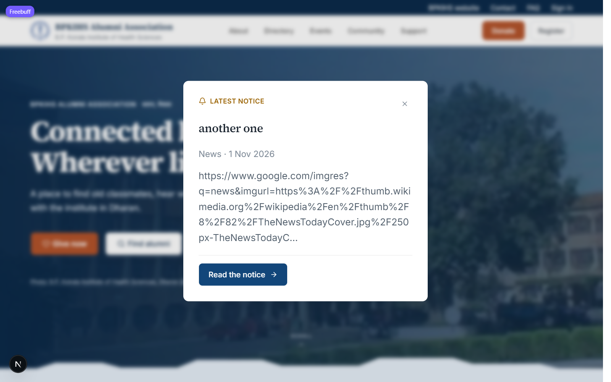

Once you close it, the popup will not nag you again during the same visit, and nothing
stays behind in a corner afterwards.

### 1.2 The home page

The home page greets returning visitors with a short welcome, key statistics about the
alumni community, and the latest news, notices and board updates. Click any headline to
read it in full.

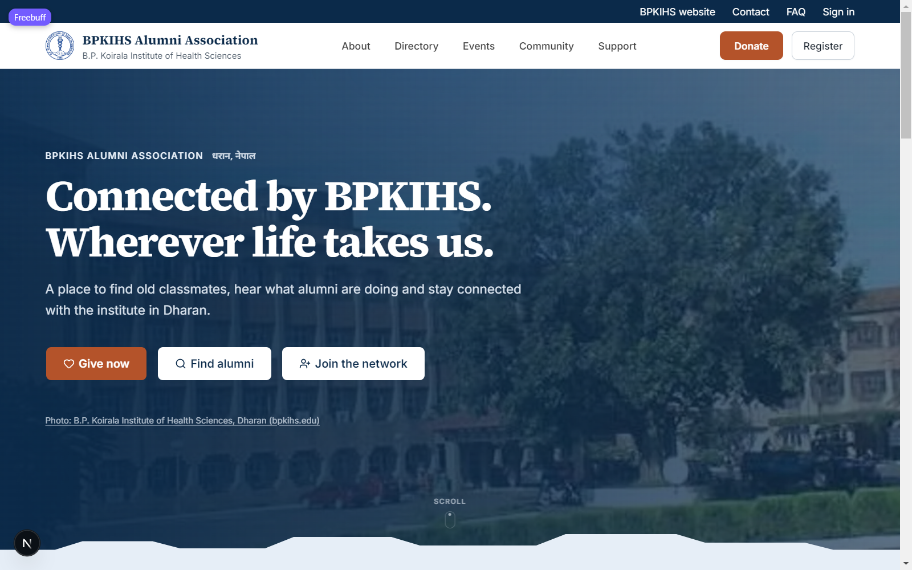

### 1.3 Alumni directory

The [directory](http://localhost:3000/directory) lists alumni with public profiles.
You can search by name, programme, workplace or place, filter by programme and batch
year, and sort the results.

- **Signed out** you see public profiles only.
- **Members** see contact details that the owner has set to members-only.

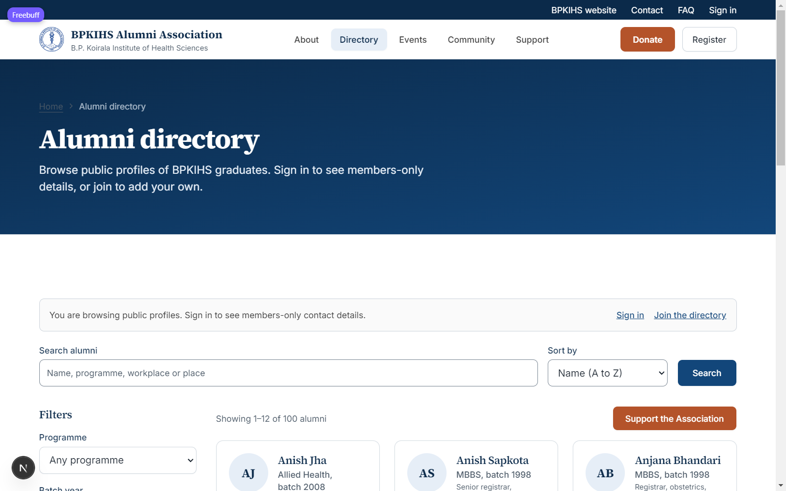

### 1.4 Events

The [events page](http://localhost:3000/events) shows upcoming reunions, health camps
and continuing-education events, plus past ones. Open an event and use the RSVP form to
say you are coming and how many you are bringing.

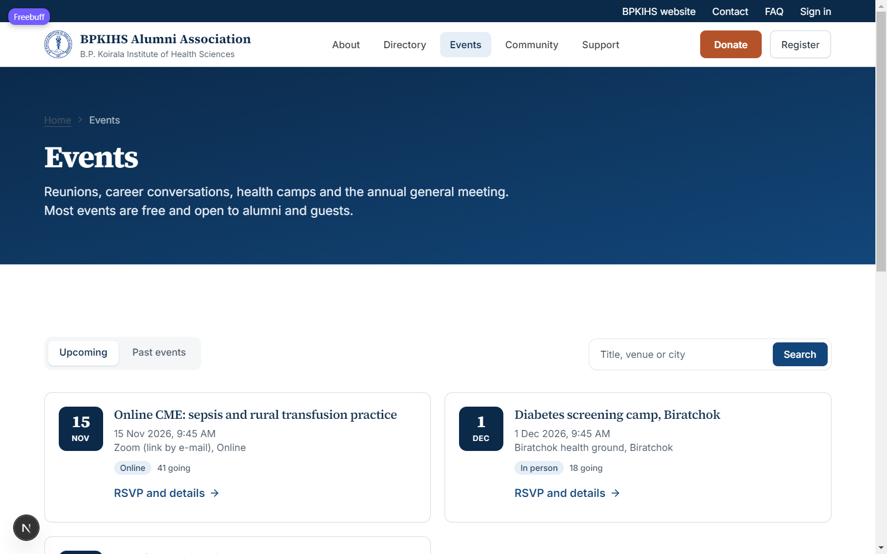

### 1.5 Giving

The [donate page](http://localhost:3000/donate) lists the Association's current giving
goals — with live progress bars — and its general fund. Choose a suggested amount or
enter your own; checkout happens on the payment provider's secure page, never on this
site.

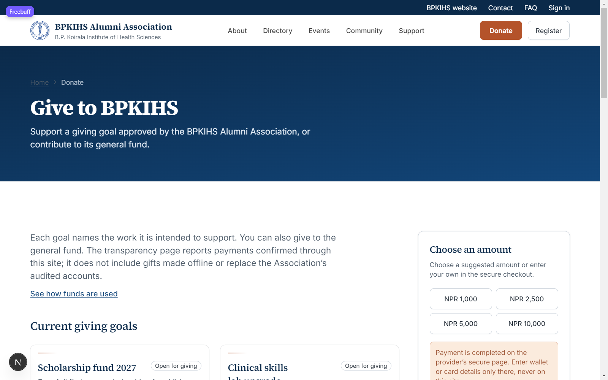

### 1.6 Community

Anyone can read the [community feed](http://localhost:3000/community). Approved members
may submit **stories, achievements and in-memoriam tributes** there. News, notices and
events are issued by the Association office only and never appear in the member's
submission form.

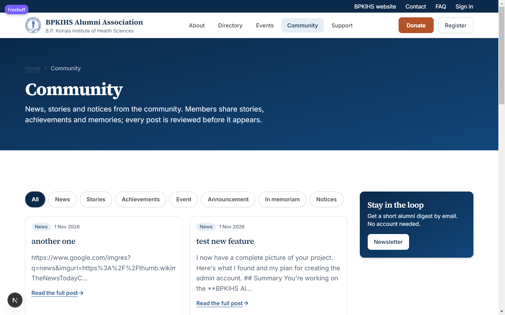

### 1.7 Support

The [support page](http://localhost:3000/support) has the office's contact details and a
helpdesk form. Pick a topic so the message reaches the right person; replies go to the
email you enter. The FAQ answers the most common questions first.

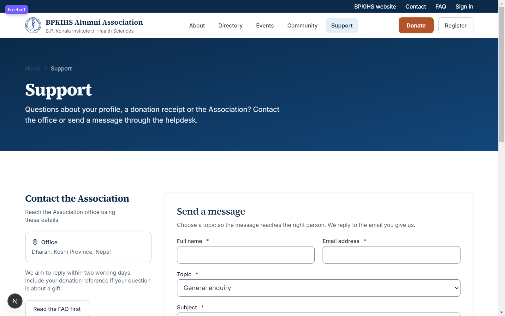

---

## 2. Joining and accounts

### 2.1 Registration

From **Register** (top right), an alumnus of BPKIHS creates their account: name,
email, programme, batch year and current work. Submitting the form sends a six-digit
confirmation code to the email address given — enter it on the next screen to confirm
the account.

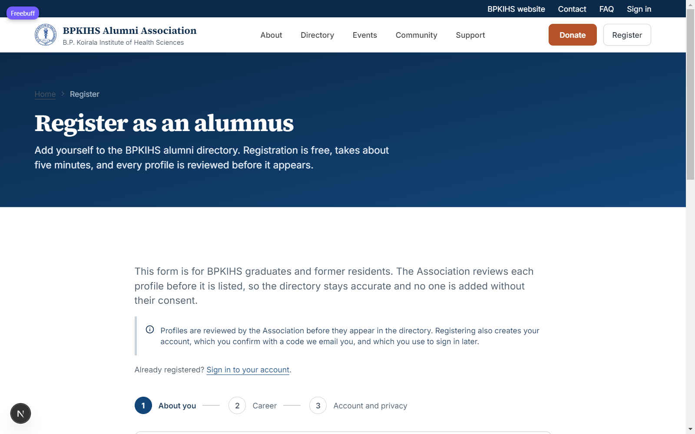

A new registration starts as **pending**. The Association office reviews it; only when
approved does the profile appear in the directory and alumni-only features open.

### 2.2 Sign in

[Sign in](http://localhost:3000/sign-in) with your email and password. "Forgotten your
password?" emails a reset link. "Sign in to the dashboard" at the bottom is for
administrators only.

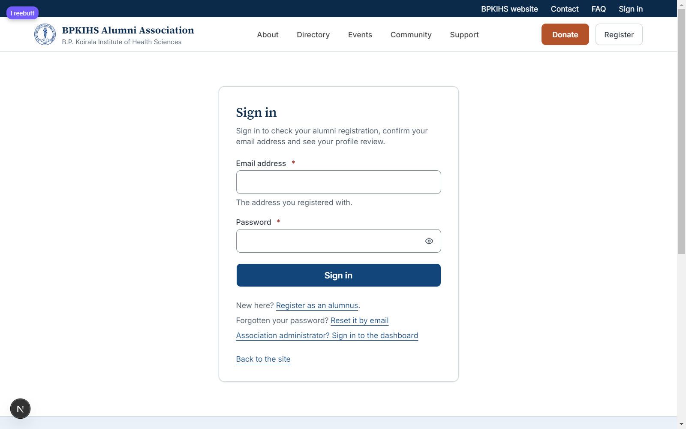

### 2.3 Your account page

The account page is the member's home: it shows your profile photo, review status
(Approved and listed / Pending review), account type and directory visibility, with
**Edit your profile** and **Sign out** at hand.

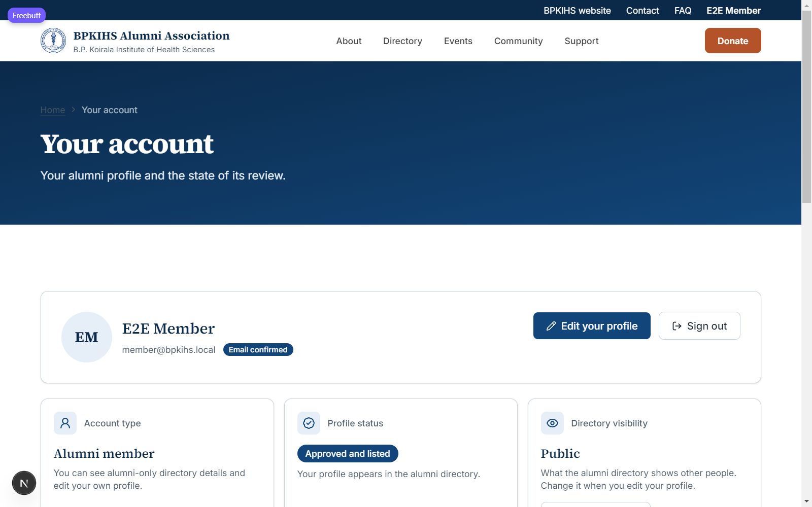

---

## 3. For members

### 3.1 Editing your profile

From the account page, **Edit your profile** lets you change your photo (processed to a
512 px web image), workplace, role, place, expertise tags, the short bio, and how public
your entry is:

| Visibility   | Who can see it                                   |
| ------------ | ------------------------------------------------ |
| **Public**   | anyone, including search engines                 |
| **Alumni only** | signed-in alumni (and the office) only        |
| **Hidden**   | only you and the office                          |

Changes to marked fields are re-reviewed by the office before publishing.

### 3.2 Sharing a story

On Community, the **Share your story** form accepts story, achievement and
in-memoriam posts. Submissions wait in **Pending review**; the office approves or
rejects them from the dashboard. You receive the outcome by email if you registered a
confirmed account.

### 3.3 Newsletter

From any page footer, subscribe with your email and choose interests
(news / events / giving / stories). A confirmation email must be clicked before you
receive anything, and every email has an unsubscribe link.

---

## 4. For administrators

### 4.1 Admin sign-in and dashboard

Administrators sign in at **`/admin/sign-in`** — the break-glass credential command
below is how a lost password is recovered. Production requires a **totp
authenticator app** for admin accounts; an admin without it can only see security
settings.

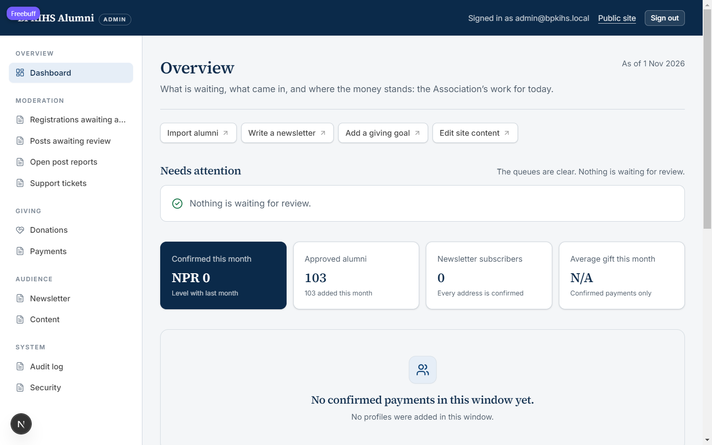

The dashboard's overview shows what needs attention: registrations awaiting approval,
posts to review, open reports, support tickets, donations confirmed this month and
approved alumni counts.

### 4.2 Moderation queues

- **Registrations awaiting approval** — approve or decline a pending alumnus; approval
  lists them in the directory.
- **Posts awaiting review** — approve, reject (with a reason) or edit a member
  submission; publishing immediately places it in the feed and can trigger the notice
  popup when it is a fresh *notice* post.
- **Open post reports** — triage reports members filed on feed items.
- **Support tickets** — respond to and close helpdesk messages.

### 4.3 Payments and events

- **Donations** records each gift, its goal, and its confirmation state.
- **Payments** is the provider-side log (eSewa, Khalti, ConnectIPS).
- RSVPs for events are visible in the events area of Content.

### 4.4 Newsletter

**Newsletter** composes a campaign to confirmed subscribers — subject, body, schedule —
and shows sending progress per batch. Limits: 50 per batch, 2000 recipients.

### 4.5 Content — notices, news, events and goals

**Content** is where the office publishes everything the public sees. Tabs: events,
giving goals, progress updates, funds breakdown, board, FAQ and welcome message. Use
**+ Add new** to create records; a fresh **notice** post becomes the first-visit popup
described in section 1.1.

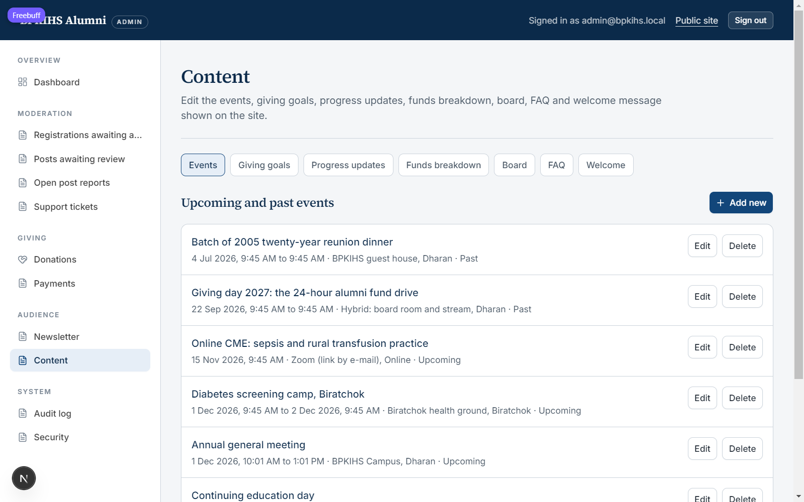

### 4.6 Audit log and security

Every admin action is written to the audit log, and the Security tab manages data
exports and the dashboard's session rules.

---

## 5. Giving and payments

1. On `/donate`, choose a goal or the general fund and an amount.
2. Checkout opens on the provider (eSewa / Khalti / ConnectIPS).
3. When the provider confirms the payment, the gift is recorded, receipts are emailed,
   and the fund breakdown and goal progress update.
4. Offline giving (bank transfer) is shown on the donate page when the office has
   published its bank account details.

_amounts are recorded in **NPR**, stored internally in paisa._

---

## 6. The database and Drizzle Studio

Run `npm run db:studio` (or it may already be running), then open **<https://local.drizzle.studio/>**
in any browser — the local Drizzle Studio connects to the running database automatically.

- **Schema** tab lists every table with row counts: today's database holds 103 alumni,
  15 feed posts, 9 giving goals, 8 events, 7 board members, 4 FAQ items and more.
- **Data** tab shows rows and lets you filter, edit and delete records. (Edits here
  bypass the application's audit log — prefer the dashboard for content.)
- **SQL console** runs raw PostgreSQL for anything else.

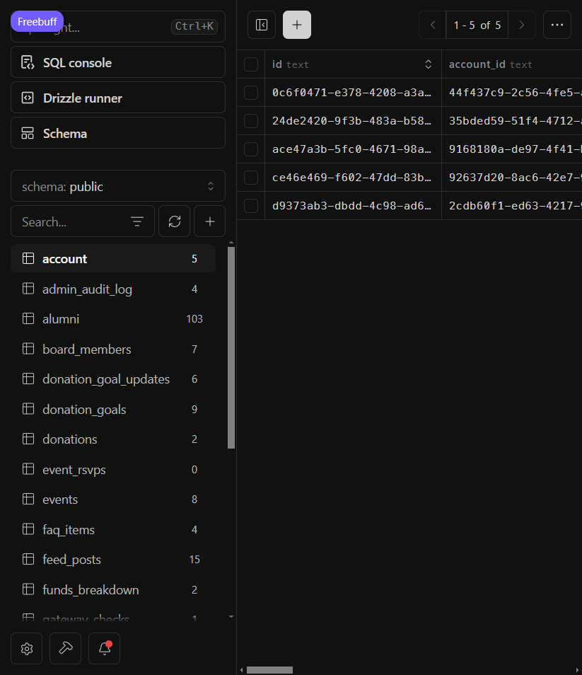

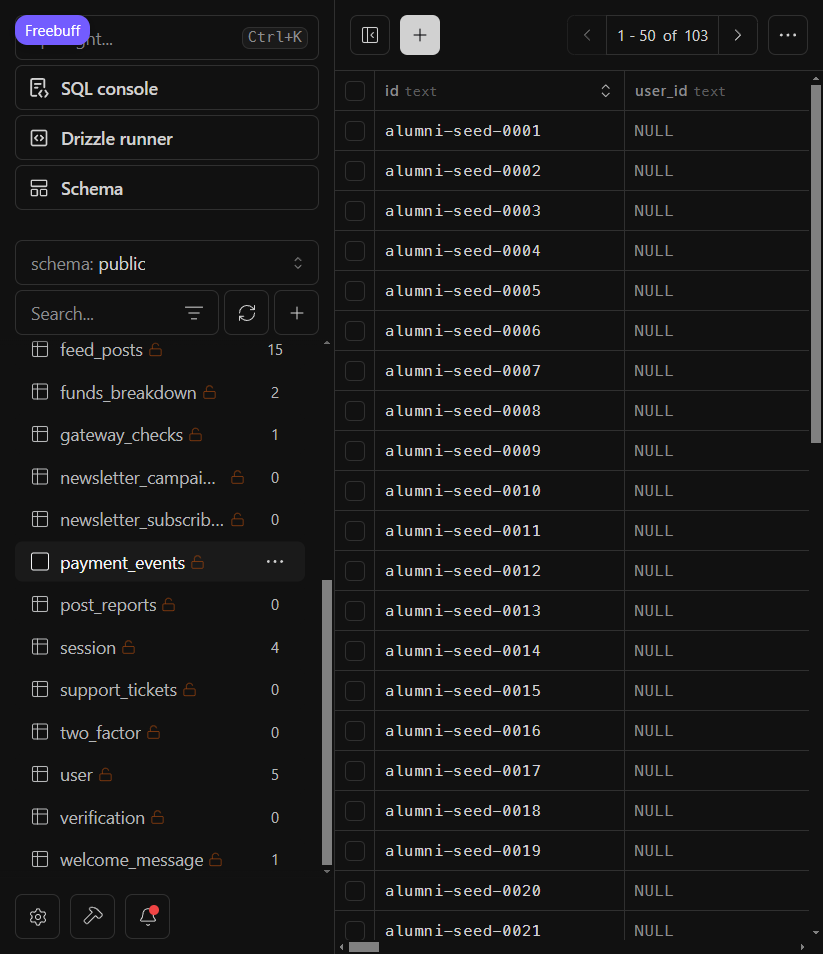

> ⚠️ **Local only.** `local.drizzle.studio` connects to a database running on your
> computer through a local certificate. Never use it against a production database.

---

## 7. Operator runbook — hosting on Vercel + Neon

This section is aimed at the office's technical operator with the credentials.

### 7.1 Accounts needed

| Account  | Purpose                                                                |
| -------- | ---------------------------------------------------------------------- |
| **Neon** | free-tier Postgres 16 database; the one place application data lives   |
| **Vercel** | free-tier Node.js hosting for the Next.js site                       |
| **Resend** | sending email (registration codes, receipts, newsletter)             |
| **eSewa / Khalti** | real donation payments (Association merchant accounts)        |

### 7.2 Step 1 — create the Neon database

```bash
neon projects create --name bpkihs-alumni
neon connection-string <project-id> <branch-id>
# copies the pooled DATABASE_URL, like
# postgres://bpkihs_owner:<password>@ep-xxx-pooler.region.aws.neon.tech/neondb?sslmode=require
```

Store it — it is the production `DATABASE_URL`.

### 7.3 Step 2 — prepare the schema and data

```bash
DATABASE_URL="<pooled-neon-url>" npm run db:migrate   # apply the schema
DATABASE_URL="<pooled-neon-url>" npm run db:alumni    # optional: demo seed *dev only*
DATABASE_URL="<pooled-neon-url>" npm run db:seed-content
DATABASE_URL="<pooled-neon-url>" ADMIN_EMAIL=office@bpkihs.org.np ADMIN_PASSWORD='…' ADMIN_NAME='…' npm run db:admin
```

> Do **not** run `db:alumni` against a real production database — it inserts demo
> alumni. Real data comes from the CSV import in the dashboard instead.

### 7.4 Step 3 — connect the repository to Vercel

```bash
vercel login                     # once, in a terminal where you can open a browser
vercel link                      # or: vercel link --project bpkihs-alumni
vercel --prod                    # first deployment
```

Or import the GitHub repository at <https://vercel.com/new> with **Default environment:
production**.

### 7.5 Step 4 — set the required environment variables

Set these in *Vercel → Project → Settings → Environment Variables* (or `vercel env add`):

| Variable                    | Value                                                                                       |
| --------------------------- | ------------------------------------------------------------------------------------------- |
| `DATABASE_URL`              | the Neon **pooled** connection string                                                       |
| `APP_URL`                   | `https://your-domain` (https required)                                                       |
| `NEXT_PUBLIC_SITE_URL`      | `https://your-domain`                                                                       |
| `BETTER_AUTH_SECRET`        | `node -e "console.log(require('crypto').randomBytes(32).toString('base64url'))"`            |
| `EMAIL_TRANSPORT`           | `resend`                                                                                     |
| `RESEND_API_KEY`            | from resend.com, with your verified domain                                                   |
| `EMAIL_FROM`                | `BPKIHS Alumni Association <no-reply@your-domain>`                                           |
| `PAYMENT_MODE`              | `sandbox` until the real merchant credentials exist                                           |
| `ESEWA_PRODUCT_CODE` / `ESEWA_SECRET_KEY` / `ESEWA_GATEWAY_URL` | from developer.esewa.com.np — sandbox first, then live                     |
| `KHALTI_SECRET_KEY` / `KHALTI_BASE_URL` | from docs.khalti.com                                                              |
| `TURNSTILE_SECRET_KEY`, `NEXT_PUBLIC_TURNSTILE_SITE_KEY` | from dash.cloudflare.com/?to=/:account/turnstile; site key must be set before `next build` |
| `CONTACT_EMAIL`             | the office address shown on /support                                                          |

Optional but recommended:

| Variable                                        | Purpose                                 |
| ----------------------------------------------- | --------------------------------------- |
| `ASSOCIATION_REGISTRATION_NUMBER`, `ASSOCIATION_PAN` | legal identifiers printed on receipts |
| `BANK_NAME`, `BANK_ACCOUNT_NAME`, `BANK_ACCOUNT_NUMBER` | offline-giving details            |
| `IMAGE_HOSTS`                                   | coming images from a non-default host   |

After the first deployment, register the payment return URLs and Resend-bound return
URLs under the final HTTPS domain.

### 7.6 Step 5 — DNS

Point the domain’s A record at Vercel and add the SPF, DKIM and DMARC records Resend
issued for the sending domain. Test that email actually arrives before launch.

### 7.7 Daily operations

- **Database backups**: Neon point-in-time restore is enabled; export CSV from the
  admin dashboard for a portable copy.
- **Photos**: stored on the app server. This layout requires a long-lived VM — for
  Vercel, point `PHOTO_UPLOAD_DIR` at `/tmp` only for demos; for a durable home, move
  to object storage (see limitations).
- **Password reset**: members can self-serve from /sign-in; admins follow §1 or §4 of
  `HANDOVER.md`.

---

## 8. Command reference

| Command                      | What it does                                            |
| ---------------------------- | ------------------------------------------------------- |
| `npm run dev`                | start the Next.js site at <http://localhost:3000>       |
| `npm run build`              | production build (what Vercel runs)                     |
| `npm run db:up` / `db:down`  | start/stop the local Docker Postgres                    |
| `npm run db:migrate`         | apply schema migrations                                 |
| `npm run db:alumni`          | seed ~100 demo alumni (dev and demo databases only)     |
| `npm run db:seed-content`    | seed the notice/news/events/goals/board/FAQ sample rows  |
| `npm run db:fixtures`        | seed the e2e demo accounts (admin/member/donor)         |
| `npm run db:admin`           | create or reset an administrator account                |
| `npm run db:studio`          | run Drizzle Studio → open <https://local.drizzle.studio/> |
| `npm run db:backup`          | dump the database to a .sql file                        |
| `npm run test`               | unit tests (387)                                        |
| `npm run test:e2e`           | browser tests with Playwright — also seeds fixtures     |
| `npm run ci`                 | format + types + lint + tests + build (the commit gate) |
| `npm run check:env`          | verify the environment is usable                        |
| `npm run check:health`       | app health check                                        |

**Demo sign-in fixtures** (dev database only, seed with `npm run db:fixtures`):

| Role    | Email                | Password          |
| ------- | -------------------- | ----------------- |
| admin   | admin@bpkihs.local   | `E2eTestAdmin!99` |
| member  | member@bpkihs.local  | `MemberPass!2026` |
| donor   | donor@example.com    | `Donor12345!`     |

The `.local` email can never be used in production.

---

## 9. Troubleshooting and known limitations

| Symptom                                      | Cause and fix                                                                 |
| -------------------------------------------- | ----------------------------------------------------------------------------- |
| Registration code never arrives              | `EMAIL_TRANSPORT=console` prints codes to the server terminal; in production check RESEND_API_KEY and the SPF/DKIM records |
| A page 500s mentioning payment or Turnstile  | production refuses to start without `PAYMENT_MODE` + gateway credentials and the two Turnstile keys — set them |
| Admin sees only `/admin/security`            | the account has no TOTP 2FA — enrol from there; it is required in production   |
| Notice popup does not appear                 | it shows only for a *notice* post newer than anything you have already seen this browser visit |
| Photo upload fails                           | the upload directory must be writable and survive deploys — see §7.7          |
| `pkill` on Windows KFS process               | use Task Manager or `Stop-Process` rather than closing the terminal while it holds a port |

**Platform limitations worth knowing before launch**

- Payment adapter coverage: **eSewa, Khalti, ConnectIPS** live; **Fonepay** planned
  (see `TRACKER.md` C7b).
- Photo uploads live on the filesystem, which works on a VM but not durably on
  serverless hosts like Vercel; until object storage is added, keep photo uploads
  small and knowing they may not survive a redeploy.
- The site assumes the office owns the Association's legal identifiers and real
  merchant accounts; until those are supplied, `PAYMENT_MODE=sandbox` takes no real
  money.

---

*Manual generated 1 Nov 2026 for BPKIHS Alumni Association. Questions about the
software: the operator handover and runbooks are in `HANDOVER.md`, `docs/HOWTO.md`,
`docs/BACKEND.md` and `docs/DB-AND-PAYMENTS.md`.*
